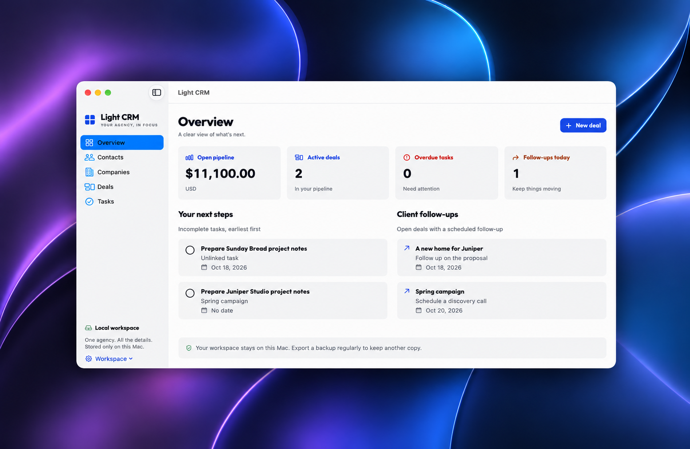

# Light CRM

A native, offline macOS CRM for a one-person web agency. Keep clients, projects, documents, and next steps in one local workspace. Built with SwiftUI and SwiftData, with an original flat visual identity and bundled Outfit typography.



There are no accounts, servers, cloud sync, analytics, subscriptions, or runtime downloads. Website and email actions explicitly open your chosen Mac application.

## What works

- **Overview:** persisted open pipeline value, active deal count, overdue tasks, follow-ups due today, and linked lists of upcoming work.
- **Contacts and companies:** searchable tables, inspectors, explicit save/cancel editing, related records, email/website actions, and relationship-aware deletion.
- **Deals:** six stages, board and sortable table views, search and stage filters, drag between columns or use the stage menu, optional company/contact, service, value, target launch, next action, follow-up, and notes. Multiple deals can belong to one client.
- **Tasks:** upcoming (including undated), overdue, and completed views; linked contacts/deals; completion, editing, and deletion.
- **Documents:** import individual local files through a native picker or drop area; unique managed copies with original display names; open, Reveal in Finder, and confirmed removal.
- **Backups:** portable versioned folders, streamed SHA-256 integrity checks, relationship/path validation, staged restoration, and a safety backup before replacement.
- **Mac conveniences:** Command-N, Command-F, native tables and date pickers, resizable window, collapsible inspector, saved deals-view and appearance preferences, light/dark/system appearance, explicit optional sample data.

## Requirements and setup

- macOS **27.0 or later**. This is the existing project deployment target; it has not been raised or lowered.
- Xcode **27.0 or later**, with its macOS SDK and command-line tools selected.
- No package dependencies or paid services. The Swift package in this repository is only a test harness over the app's actual model/storage source files.

Open `Light CRM.xcodeproj`, select the shared **Light CRM** scheme and **My Mac**, then Run. For a signed local build, select your own team in Signing & Capabilities. The existing author signing configuration and bundle identifier are preserved; contributors do not need that team or its credentials.

To verify without signing:

```sh
xcodebuild build -project 'Light CRM.xcodeproj' -scheme 'Light CRM' \
  -destination 'platform=macOS' -derivedDataPath /tmp/LightCRMBuild \
  CODE_SIGNING_ALLOWED=NO DEVELOPMENT_TEAM=
swift test --scratch-path /tmp/LightCRMTests
python3 scripts/check-contrast.py
```

Unsigned builds are for local development, not distribution. A downloadable release would need its own signing and notarization process.

The first launch is empty. Use **Load sample data** to insert fictional clients and projects, or create your own first record. Sample data is never inserted automatically and cannot be loaded into a nonempty workspace.

## Daily workflow

1. Create a company and a contact, then a deal for each project.
2. Set an estimated value, next action, and optional follow-up date.
3. Move the deal through New inquiry → Discovery → Proposal sent → Awaiting commitment → Won/Lost. Board and table use the same saved records.
4. Add tasks and link them to a contact or deal. Undated incomplete tasks remain visible in Upcoming. Overdue is an additional focused view.
5. Select a contact/deal to import documents in the inspector. Double-click a table row to edit; use the inspector for details and related-record links.

Use **Workspace → Currency** to choose the app-wide ISO currency (initially suggested from your locale). Changing currency relabels amounts; it does **not** convert them. Amounts are stored as canonical decimal strings, limited to 999,999,999,999 with up to three fractional digits, and formatted according to locale/currency conventions. Editors accept the locale decimal separator without grouping separators. Display rounding follows the currency's standard precision.

Dates are Gregorian calendar days stored as year/month/day, not midnight timestamps. The same due day survives time-zone and daylight-saving changes; its display follows your locale.

## Local data

Use **Workspace → Show Local Storage** to find the exact directory. The app asks Foundation for the user's Application Support directory and creates `LightCRM` within it:

```text
Application Support/LightCRM/
  CRM.store                    SwiftData SQLite store
  CRM.store-wal / CRM.store-shm SQLite sidecars when present
  Attachments/                 managed files, sometimes in restore-generation folders
  Safety Backups/              pre-restore .lightcrmbackup folders
```

For a sandboxed build, Application Support is inside the app container under `~/Library/Containers/<resolved-bundle-identifier>/Data/Library/Application Support/`. An unsigned/unsandboxed development launch can use `~/Library/Application Support/LightCRM/` instead. Changing your bundle identifier may create a different sandbox container. Transfer data using a backup rather than moving a live database.

No database, document, or backup belongs in the repository. `.gitignore` excludes these and local signing files. Preferences for appearance and deals view use `UserDefaults` and are not part of portable backups.

**Local storage is not app-level encryption.** Database records, managed documents, and backup JSON are readable to an account/process with filesystem access. The app does not implement encryption. FileVault and backup storage protections are separate user/OS choices.

## Backup and restore

**Export:** choose **Workspace → Export Backup**, select a destination folder, and wait for success. A uniquely named `.lightcrmbackup` folder is created there. Existing exports are not overwritten. Keep the entire folder together; it is not a zip archive.

```text
LightCRM-….lightcrmbackup/
  manifest.json      format identifier, version 1, creation date, counts, records checksum
  records.json       contacts, companies, deals, tasks, relationships, document metadata, currency
  attachments/       copied managed documents with integrity checksums in records.json
```

**Restore:** choose **Workspace → Restore Backup**, select the backup folder, and confirm replacement. Restore replaces all current records, documents, and currency. It validates identifiers, relationship kinds, counts, dates, amounts, file sizes, checksums, and relative paths. Unsupported versions, missing files, path traversal, aliases, and symbolic links are rejected.

Before changing the database, the app exports the current workspace to `Safety Backups/`, then stages incoming files in a fresh managed directory. It rechecks copied files and commits all database changes in one explicit save. Failure before that commit rolls back records and removes staged files. Old files are removed only after success; cleanup failures are reported and leave harmless unreferenced files. A process interruption before commit can also leave unreferenced staging files, but existing documents remain intact.

If a current managed document is missing or unreadable, the safety export fails and restore stops. Repair/reimport the missing document or remove its broken attachment entry before retrying. This deliberately avoids replacing data without a complete safety copy. You can restore a safety backup through the same menu. Safety backups are retained until you remove them yourself in Finder.

Checksums detect corruption; they are not signatures or proof of who created a backup. Use backups from trusted sources. Metadata is limited to 100 MB for records and 1 MB for the manifest; document copies/checksums are streamed/off the UI actor. Backup/export requires enough free disk space for another full copy.

## Architecture

- `Models/CRMRecord.swift`: SwiftData typed record graph, attachment and settings models, stable UUIDs, civil dates, decimal money, and Codable transfer types. The single record entity shares common fields and uses a validated kind plus actual optional SwiftData relationships for company/contact/deal links. Kind-specific editors expose only relevant fields.
- `Storage/CRMStore.swift`: main-actor repository and explicit database transactions. Autosave is disabled. Editors use value drafts; Cancel cannot mutate saved records. Failures roll back and display errors.
- `Storage/FileVault.swift`: actor for file copies, streaming checksums, backup validation, export, and restore staging. Only relative managed paths enter the database. Temporary security-scoped access ends after each operation.
- `Views/`: design tokens, lists/board, overview, editor, inspector, and native window close protection. SwiftUI observation keeps all representations current.
- `ContentView.swift` / `MyApp.swift`: single-window navigation, app commands, native file panels, and startup error handling. No store is silently reset on failure.

Deleting a company/contact unlinks surviving deals/tasks and other relationships. Deleting a deal preserves its tasks and unlinks them. Only owned attachment metadata cascades. The confirmation explains affected links and managed files; originals are never deleted.

The flat palette uses 8-point cards, a 4-point spacing scale, opaque surfaces, SF Symbols, and Outfit. Smaller native system labels/numerals retain platform legibility. A rounded system fallback is available if font registration fails. See [third-party notices](THIRD_PARTY_NOTICES.md). No branding or implementation was copied from workflow references [Twenty](https://twenty.com/) or [Capsule](https://capsulecrm.com/support/calendar-and-tasks/using-tasks-for-sales-and-projects/).

## Verification and limitations

See [VERIFICATION.md](VERIFICATION.md) for checks actually performed and their limits, and [CONTRIBUTING.md](CONTRIBUTING.md) for the manual QA checklist. CI builds without signing secrets on GitHub's [Xcode 27 runner](https://github.blog/changelog/2026-10-15-xcode-27-runner-image-generally-available/). The workflow is prepared but has not been executed on GitHub as part of this implementation.

Version one is a single-user, single-workspace, single-currency app. No CSV import, recurring tasks, reminders/notifications, rich-text notes, automatic backups, cloud sync, multiwindow editing, or document preview is included. There is no general undo for committed edits/deletions; use an exported backup to recover. Individual regular files are supported; folders, Finder aliases, and symlinks are not. Filenames may repeat safely. Very large record collections are not a target: records are loaded into memory and filtering is local. File work is off the main actor; very large database replacements may still briefly occupy it. Full VoiceOver and multi-locale testing remain useful contributor work.

## License

App code: [MIT](LICENSE). Outfit: SIL Open Font License 1.1, bundled with the font. Apple system frameworks and SF Symbols remain subject to Apple's terms.
